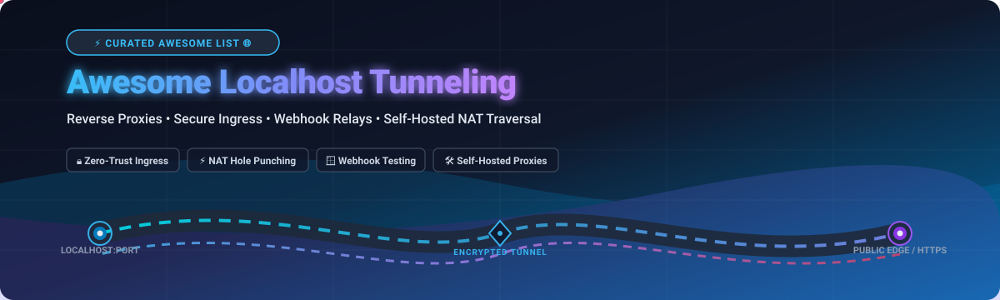

# ⚡ Awesome Localhost & Private Network Tunneling 🌐

<div align="center">

<a href="https://github.com/ishandutta2007/Awesome-Awesome-Awesome"></a><a href="https://discord.gg/jc4xtF58Ve"></a>
[](LICENSE)
[](CONTRIBUTING.md)
[](https://github.com/ishandutta2007/Awesome-Localhost-Private-Network-Tunneling)
<a href="https://github.com/ishandutta2007"></a>

<br/>
<br/>

<p align="center">
  
</p>

> **A curated, comprehensive catalog of enterprise-grade SaaS and cutting-edge Open-Source Localhost Tunneling solutions, secure reverse proxies, zero-trust edge tunnels, NAT traversal tools, and webhook testing relays for exposing local dev servers to the world.**

[](https://github.com/ishandutta2007/Awesome-Localhost-Private-Network-Tunneling/stargazers)
[](https://github.com/ishandutta2007/Awesome-Localhost-Private-Network-Tunneling/network/members)

</div>

---

## 📑 Table of Contents

- [🌐 Sector Overview & Market Dynamics](#-sector-overview--market-dynamics)
- [🏢 SaaS / Hosted Platforms](#-saas--hosted-platforms)
  - [📊 SaaS Platforms Comparison Table](#-saas-platforms-comparison-table)
  - [🔍 Detailed SaaS Profiles](#-detailed-saas-profiles)
- [🟩 Open-Source Software](#-open-source-software)
  - [⭐ Open-Source Tunneling Tools Table](#-open-source-tunneling-tools-table)
  - [🛠️ Detailed Open-Source Profiles](#-detailed-open-source-profiles)
- [⚖️ Architecture Matrix: Self-Hosted vs Managed Cloud Ingress](#️-architecture-matrix-self-hosted-vs-managed-cloud-ingress)
- [📈 Star History](#-star-history)
- [💖 Support](#-support)
- [🤝 Contributing](#-contributing)
- [📄 License](#-license)

---

## 🌐 Sector Overview & Market Dynamics

The global localhost tunneling, secure edge ingress, and Zero Trust Network Access (ZTNA) sector is currently valued at an estimated **$3.5–$4.2 billion** and is projected to exceed **$9.8 billion by 2030**, advancing at a Compound Annual Growth Rate (**CAGR of ~16.8%**). Driven by distributed remote teams, microservice local debugging, API webhook verification (Stripe, GitHub, Twilio), and the migration from brittle corporate VPNs to software-defined perimeters, secure ingress tunneling has transitioned from a developer utility into mission-critical infrastructure.

The sector exhibits **moderate fragmentation across specialized developer utilities, while leaning toward consolidation at the enterprise security and cloud edge layer**. Hyper-scale network operators and CDN titans (Cloudflare, Tailscale) anchor the zero-trust network space, whereas specialized developer-first tunnels (ngrok, LocalXpose) and enterprise QA cloud testing grids (BrowserStack, Sauce Labs, LambdaTest) command robust, defensible niches. Concurrently, a vibrant open-source ecosystem (frp, nps, Chisel, Rathole) empowers self-hosters to retain 100% data sovereignty without external bandwidth caps.

---

## 🏢 SaaS / Hosted Platforms

Managed cloud-hosted tunneling services provide turnkey global infrastructure, automated TLS certificate provisioning, inspection dashboards, and access control policies without requiring users to configure public VPS nodes.

### 📊 SaaS Platforms Comparison Table

*The table is sorted by company size (valuation / revenue) in descending order.*

| Platform | Company Size (Valuation / Revenue) | Starting Tier Pricing | Free Tier Limits / Trial | Custom Domain Support | Webhook Inspection | Single Sign-On (SSO) / Auth | Best For |
|:---|:---|:---|:---|:---:|:---:|:---:|:---|
| **[Cloudflare Tunnel](https://www.cloudflare.com/products/tunnel/)** | ~$35B+ Market Cap / $1.6B+ ARR | **$7/user/month** (Zero Trust Standard; Tunnel daemon free) | **100% Free forever** for up to 50 Zero Trust users with unlimited tunnels | ✅ Included free | ✅ Via Cloudflare Logs | ✅ Google, GitHub, Okta, SAML | Zero-trust edge ingress & unlimited traffic |
| **[Tailscale Funnel](https://tailscale.com/kb/1223/funnel)** | ~$1.9B+ Valuation / $80M+ ARR | **$6/user/month** (Starter tier billed annually) | **Free forever plan** (Up to 3 users, 100 devices, 3 Funnel nodes) | ✅ Tailnet DNS / Custom | ❌ (CLI / Tailnet only) | ✅ Google, Microsoft, GitHub, Apple | WireGuard mesh mesh networking & secure port publishing |
| **[BrowserStack Local Testing](https://www.browserstack.com/)** | ~$4.0B Valuation / $450M+ ARR | **$29/user/month** (Automate Pro billed annually) | **1-minute automated / 30-minute interactive free trial** (Single test run) | ✅ Via Local Binary | ✅ Full DevTools capture | ✅ SAML 2.0 / Okta / Azure AD | Cross-browser & real mobile device testing on internal apps |
| **[Sauce Connect Tunnel](https://saucelabs.com/)** | ~$1.2B Valuation / $150M+ ARR | **$39/month** (Sauce Labs Live Testing) | **28-day free trial** (with 60 live and 100 automated testing minutes) | ✅ Proxy / PAC support | ✅ Network log capture | ✅ SAML 2.0 / SSO | Enterprise cloud automated testing behind corporate firewalls |
| **[LambdaTest UnderPass](https://www.lambdatest.com/support/docs/underpass/)** | ~$300M Valuation / $40M+ ARR | **$15/user/month** (Live Testing billed annually) | **Free forever tier** (60 minutes/month live browser test with tunnel) | ✅ Local proxy routing | ✅ Network waterfall logs | ✅ OneLogin, Okta, SAML | Real device testing & cross-browser QA behind NAT |
| **[ngrok](https://ngrok.com/)** | ~$250M Valuation / $35M+ ARR | **$8/user/month** (Personal tier billed annually) | **Free forever plan** (1 static domain, 1 agent tunnel, 1GB data/mo) | ✅ Paid plans (1 on Free) | ✅ Real-time web UI & replay | ✅ Google, GitHub, Auth0, OIDC | De-facto developer standard for API webhook development |
| **[Inlets SaaS (OpenFaaS Ltd)](https://inlets.dev/)** | Bootstrapped / ~$2M–$5M ARR | **$24/month** (Personal Pro annual license) | **14-day free trial** (Full feature trial license key via email) | ✅ Automated Let's Encrypt | ❌ (TCP/L4 passthrough) | ❌ (Client/Server Token) | Cloud-native Kubernetes service tunnels & TCP/UDP ingress |
| **[LocalXpose](https://localxpose.io/)** | Bootstrapped / ~$1M–$3M ARR | **$6/month** (Basic tier billed monthly) | **Free forever plan** (15-minute session timeouts, dynamic endpoints) | ✅ Custom subdomains ($6+) | ✅ Built-in CLI & GUI inspector | ✅ Basic HTTP Auth & IP Whitelist | Multi-protocol (HTTP/TCP/TLS/UDP) developer reverse proxy |
| **[Pagekite](https://pagekite.net/)** | Bootstrapped / ~$500K ARR | **$3/month** (Personal tier / Pay-what-you-can) | **30-day free trial** (Includes 2.5GB transfer; $0 free plan with daily quotas) | ✅ Custom DNS CNAME | ❌ (CLI logs) | ✅ HTTP Basic / Shared Secret | Lightweight Python-native tunneling on legacy or low-power gear |
| **[Localtunnel SaaS](https://localtunnel.me/)** | Community Hosted / $0 Commercial | **$0/month** (Community sponsored) | **100% Free forever** (Public community relay server subject to uptime) | ⚠️ Custom subdomain flag | ❌ (Terminal only) | ❌ None | Quick zero-configuration webhook tests without registration |

---

### 🔍 Detailed SaaS Profiles

#### 1. Cloudflare Tunnel (formerly Argo Tunnel)
- **Website**: [https://www.cloudflare.com/products/tunnel/](https://www.cloudflare.com/products/tunnel/)
- **Pricing**: Enterprise Zero Trust starts at **$7/user/month**; cloudflared connector daemon is free of charge.
- **Free Tier Limits**: **Free forever for up to 50 users** on Cloudflare One with unlimited tunnels and bandwidth.
- **Key Features**: Edge network routing through 300+ PoPs, outbound-only connections (no open inbound firewall ports), Zero Trust authentication rules (SSO/MFA), DDoS and WAF protection.
- **Protocols Supported**: HTTP, HTTPS, TCP, SSH, RDP, WebSockets.

#### 2. Tailscale Funnel
- **Website**: [https://tailscale.com/kb/1223/funnel](https://tailscale.com/kb/1223/funnel)
- **Pricing**: Personal plans start at **$6/user/month** (Starter tier billed annually).
- **Free Tier Limits**: **Free forever tier** with up to 3 users, 100 devices, and 3 simultaneous Funnel nodes.
- **Key Features**: Leverages WireGuard point-to-point mesh architecture, seamless transition from private tailnet routing to publicly accessible HTTPS endpoints via MagicDNS and Let's Encrypt.
- **Protocols Supported**: TCP, HTTPS, WebSockets.

#### 3. BrowserStack Local Testing
- **Website**: [https://www.browserstack.com/local-testing](https://www.browserstack.com/local-testing)
- **Pricing**: Starts at **$29/user/month** (Automate Pro billed annually).
- **Free Tier Limits**: **Free trial** offering 1 automated test session / 30 minutes of interactive manual testing.
- **Key Features**: Secure binary tunneling internal enterprise staging environments and behind-the-firewall assets to BrowserStack's real device cloud (3,000+ browsers and mobile devices).
- **Protocols Supported**: HTTP, HTTPS, WebSocket, custom proxy PAC files.

#### 4. Sauce Connect Tunnel (Sauce Labs)
- **Website**: [https://saucelabs.com/platform/sauce-connect-proxy](https://saucelabs.com/platform/sauce-connect-proxy)
- **Pricing**: Starts at **$39/month** (Live Testing plan).
- **Free Tier Limits**: **28-day free trial** with 100 automated testing minutes and 60 live minutes.
- **Key Features**: Enterprise-grade TLS proxy tunnel establishing high-throughput multiplexed connections between internal QA servers and Sauce Labs cloud VMs without firewall changes.
- **Protocols Supported**: HTTP, HTTPS, TLS, TCP.

#### 5. LambdaTest UnderPass
- **Website**: [https://www.lambdatest.com/support/docs/underpass/](https://www.lambdatest.com/support/docs/underpass/)
- **Pricing**: Starts at **$15/user/month** (Live Testing billed annually).
- **Free Tier Limits**: **Lifetime free plan** with 60 minutes/month of interactive browser testing including local tunneling.
- **Key Features**: GUI and CLI tunnel application that routes private enterprise endpoints and local staging builds directly to 3,000+ real desktop browsers and physical mobile devices.
- **Protocols Supported**: HTTP, HTTPS, SSH, WebSockets.

#### 6. ngrok
- **Website**: [https://ngrok.com/](https://ngrok.com/)
- **Pricing**: Starts at **$8/user/month** (Personal tier billed annually).
- **Free Tier Limits**: **Free forever plan** with 1 static public domain, 1 simultaneous agent tunnel, and 1GB data transfer per month.
- **Key Features**: Interactive web UI request inspector (`http://localhost:4040`), instant webhook replay, built-in OAuth/OIDC/SAML authentication, IP policy controls, and edge TLS termination.
- **Protocols Supported**: HTTP, HTTPS, TCP, TLS, WebSockets.

#### 7. Inlets SaaS / Inlets Pro
- **Website**: [https://inlets.dev/](https://inlets.dev/)
- **Pricing**: Starts at **$24/month** (Personal license billed annually).
- **Free Tier Limits**: **14-day fully functional free trial** license key issued upon email request.
- **Key Features**: Purpose-built for Kubernetes ingress and cloud-native workloads, automated automated tunnel provisioning via cloud-init, TCP/UDP multiplexing, and private ingress routing.
- **Protocols Supported**: HTTP, HTTPS, TCP, UDP, WebSockets.

#### 8. LocalXpose
- **Website**: [https://localxpose.io/](https://localxpose.io/)
- **Pricing**: Starts at **$6/month** (Basic plan billed monthly).
- **Free Tier Limits**: **Free forever plan** with 15-minute connection timeouts and dynamic randomized subdomains.
- **Key Features**: End-to-end encrypted reverse proxy, detailed CLI and web dashboard traffic inspector, custom domain CNAME routing, and password-protected endpoints.
- **Protocols Supported**: HTTP, HTTPS, TCP, TLS, UDP.

#### 9. Pagekite
- **Website**: [https://pagekite.net/](https://pagekite.net/)
- **Pricing**: Starts at **$3/month** (Personal tier / flexible pay-what-you-can model).
- **Free Tier Limits**: **30-day free trial** with 2.5GB transfer quota; community-sponsored quota accounts available.
- **Key Features**: Minimal Python-based reverse proxy designed to run seamlessly on resource-constrained devices, Raspberry Pis, routers, and legacy Linux servers.
- **Protocols Supported**: HTTP, HTTPS, SSH, raw TCP.

#### 10. Localtunnel
- **Website**: [https://localtunnel.me/](https://localtunnel.me/)
- **Pricing**: **$0** (Free, open-source community platform).
- **Free Tier Limits**: **100% Free forever** with public relay servers; subject to shared infrastructure availability.
- **Key Features**: Zero sign-up required, single npm install command, easy custom subdomain request flag (`--subdomain`), and instant public URL generation.
- **Protocols Supported**: HTTP, HTTPS.

---

## 🟩 Open-Source Software

Self-hosted, open-source tunneling solutions offer absolute data sovereignty, zero transfer fees, and unlimited concurrent connections by allowing you to deploy the relay server on your own VPS or Kubernetes cluster.

### ⭐ Open-Source Tunneling Tools Table

*The table is sorted by GitHub Stars_Count in descending order. Every badge directly links to the respective stargazers page.*

| Project | GitHub_Stars (style=social) | Language | Architecture | NAT Traversal Technique | Multi-Tenant Server | Custom Domains & TLS | Primary Use Case |
|:---|:---:|:---|:---|:---|:---:|:---:|:---|
| **[frp](https://github.com/fatedier/frp)** | [](https://github.com/fatedier/frp/stargazers) | Go | Client / Server | TCP, KCP, QUIC, Multiplexing | ✅ Yes | ✅ Let's Encrypt / Custom | High-performance reverse proxy for internal services |
| **[nps](https://github.com/ehang-io/nps)** | [](https://github.com/ehang-io/nps/stargazers) | Go | Client / Server | KCP, TCP, UDP, P2P Bridge | ✅ Yes (Web Dashboard) | ✅ Multi-host vhost routing | Full-featured intranet penetration server with web GUI |
| **[NetBird](https://github.com/netbirdio/netbird)** | [](https://github.com/netbirdio/netbird/stargazers) | Go | Mesh / Client | WireGuard + ICE / STUN / TURN | ✅ Yes | ✅ Private DNS / IP | Zero-configuration private overlay mesh network |
| **[Localtunnel Client](https://github.com/localtunnel/localtunnel)** | [](https://github.com/localtunnel/localtunnel/stargazers) | JavaScript | Client / Server | TCP Relay | ✅ Yes | ✅ Wildcard subdomains | Instant CLI webhook sharing without account creation |
| **[Nebula](https://github.com/slackhq/nebula)** | [](https://github.com/slackhq/nebula/stargazers) | Go | Mesh / Lighthouse | Noise Protocol + UDP Punching | ✅ Yes | ✅ Mesh IP / Overlay | Mutually authenticated scalable mesh overlay network |
| **[Chisel](https://github.com/jpillora/chisel)** | [](https://github.com/jpillora/chisel/stargazers) | Go | Client / Server | HTTP / WebSocket (SSH-secured) | ✅ Yes | ✅ SSH key auth | Fast TCP/UDP tunnel over firewall-friendly HTTP/WebSockets |
| **[Cloudflared](https://github.com/cloudflare/cloudflared)** | [](https://github.com/cloudflare/cloudflared/stargazers) | Go | Edge Client | Outbound HTTP/2 & QUIC | ✅ Yes | ✅ Automatic Cloudflare SSL | Official Cloudflare Zero Trust tunnel client |
| **[Rathole](https://github.com/rathole-org/rathole)** | [](https://github.com/rathole-org/rathole/stargazers) | Rust | Client / Server | Async TCP Multiplexing (Tokio) | ✅ Yes | ✅ TLS / Noise Protocol | Ultra-low memory, hyper-performance NAT traversal proxy |
| **[GOST](https://github.com/go-gost/gost)** | [](https://github.com/go-gost/gost/stargazers) | Go | Multi-Node Proxy | Multi-protocol tunnel & chains | ✅ Yes | ✅ Multi-level proxy TLS | Versatile security tunnel and proxy forwarder |
| **[wstunnel](https://github.com/erebe/wstunnel)** | [](https://github.com/erebe/wstunnel/stargazers) | Rust | Client / Server | WebSocket / HTTP/2 / WireGuard | ✅ Yes | ✅ TLS Obfuscation | Tunneling TCP/UDP traffic over restrictive proxies via WebSockets |
| **[OpenZiti](https://github.com/openziti/ziti)** | [](https://github.com/openziti/ziti/stargazers) | Go / C | Programmable Mesh | Zero Trust Overlay Network | ✅ Yes | ✅ Mutual TLS (mTLS) | Programmable application-embedded zero-trust networking |
| **[SirTunnel](https://github.com/anderspitman/SirTunnel)** | [](https://github.com/anderspitman/SirTunnel/stargazers) | Python | Caddy Plugin / SSH | Reverse SSH + Caddy API | ✅ Yes | ✅ Automatic Caddy HTTPS | Minimalist reverse-tunnel setup using plain SSH and Caddy |
| **[Boringproxy](https://github.com/boringproxy/boringproxy)** | [](https://github.com/boringproxy/boringproxy/stargazers) | Go | Client / Server | SSH + HTTPS Reverse Proxy | ✅ Yes (Web UI) | ✅ Automated Let's Encrypt | Self-hosted reverse proxy manager with automated SSL |
| **[Inlets Operator](https://github.com/inlets/inlets-operator)** | [](https://github.com/inlets/inlets-operator/stargazers) | Go | Kubernetes Controller | Automated Cloud VM Ingress | ✅ Yes | ✅ Ingress controller support | Automates public Cloud LoadBalancers for local Kubernetes |
| **[PyPagekite](https://github.com/pagekite/PyPagekite)** | [](https://github.com/pagekite/PyPagekite/stargazers) | Python | Client / Server | HTTP/1.1 Tunneling | ✅ Yes | ✅ Custom domain DNS | Core Python engine powering the Pagekite protocol |

---

### 🛠️ Detailed Open-Source Profiles

#### 1. frp (Fast Reverse Proxy)
- **Repository**: [https://github.com/fatedier/frp](https://github.com/fatedier/frp)
- **Stargazers**: [](https://github.com/fatedier/frp/stargazers)
- **Tech Stack**: Go | **License**: Apache-2.0
- **Overview**: A battle-tested reverse proxy application designed to expose internal TCP, UDP, HTTP, and HTTPS services behind NAT or firewalls to the public internet. Features multi-tenant authentication, connection pooling, traffic encryption, and custom domain header rewrites.
- **Quickstart**:
  ```bash
  # Start server on VPS:
  ./frps -c ./frps.ini
  # Expose local port 8080 from client:
  ./frpc http -s vps_ip:7000 -l 8080 -d dev.example.com
  ```

#### 2. nps (Intranet Penetration Server)
- **Repository**: [https://github.com/ehang-io/nps](https://github.com/ehang-io/nps)
- **Stargazers**: [](https://github.com/ehang-io/nps/stargazers)
- **Tech Stack**: Go | **License**: Apache-2.0
- **Overview**: Comprehensive intranet penetration and tunneling framework featuring an intuitive multi-tenant web administration dashboard. Supports TCP/UDP forwarding, HTTP proxying, SOCKS5 proxies, and P2P direct connections.

#### 3. NetBird
- **Repository**: [https://github.com/netbirdio/netbird](https://github.com/netbirdio/netbird)
- **Stargazers**: [](https://github.com/netbirdio/netbird/stargazers)
- **Tech Stack**: Go, WireGuard | **License**: BSD-3-Clause
- **Overview**: Open-source zero-trust networking platform combining WireGuard encryption with automated NAT hole punching (STUN/TURN/ICE). Seamlessly interconnects local dev environments, Kubernetes clusters, and cloud workloads into an encrypted private mesh.

#### 4. Localtunnel Client & Server
- **Repository**: [https://github.com/localtunnel/localtunnel](https://github.com/localtunnel/localtunnel)
- **Stargazers**: [](https://github.com/localtunnel/localtunnel/stargazers)
- **Tech Stack**: Node.js / JavaScript | **License**: MIT
- **Overview**: The classic, lightweight CLI tool that pioneered frictionless localhost sharing for web developers. Requires zero configuration or user registration; can be pointed to custom self-hosted server instances (`localtunnel/server`).
- **Quickstart**:
  ```bash
  npx localtunnel --port 3000 --subdomain my-super-cool-app
  ```

#### 5. Slack Nebula
- **Repository**: [https://github.com/slackhq/nebula](https://github.com/slackhq/nebula)
- **Stargazers**: [](https://github.com/slackhq/nebula/stargazers)
- **Tech Stack**: Go | **License**: MIT
- **Overview**: A scalable, mutually authenticated overlay networking tool originally created by Slack. Focuses on security, discoverability, and portable firewall rules across any operating system or cloud provider.

#### 6. Chisel
- **Repository**: [https://github.com/jpillora/chisel](https://github.com/jpillora/chisel)
- **Stargazers**: [](https://github.com/jpillora/chisel/stargazers)
- **Tech Stack**: Go | **License**: MIT
- **Overview**: High-speed, secure TCP and UDP tunnel encapsulated over HTTP and wrapped in SSH. Because connections appear as standard HTTP/1.1 or WebSocket traffic, Chisel excels at penetrating rigid corporate firewalls and restrictive proxy inspection barriers.
- **Quickstart**:
  ```bash
  # Run server:
  chisel server -p 8080 --reverse
  # Expose local port 3000 through the server:
  chisel client https://server.com:8080 R:80:localhost:3000
  ```

#### 7. Cloudflared
- **Repository**: [https://github.com/cloudflare/cloudflared](https://github.com/cloudflare/cloudflared)
- **Stargazers**: [](https://github.com/cloudflare/cloudflared/stargazers)
- **Tech Stack**: Go | **License**: Apache-2.0
- **Overview**: The official open-source client for Cloudflare Tunnel. Runs an agent daemon on your host that creates outbound-only connections to Cloudflare edge data centers, exposing local services without opening public ports.
- **Quickstart**:
  ```bash
  cloudflared tunnel --url http://localhost:8000
  ```

#### 8. Rathole
- **Repository**: [https://github.com/rathole-org/rathole](https://github.com/rathole-org/rathole)
- **Stargazers**: [](https://github.com/rathole-org/rathole/stargazers)
- **Tech Stack**: Rust, Tokio | **License**: Apache-2.0 / MIT
- **Overview**: A hyper-fast, lightweight reverse proxy written in Rust, engineered as an ultra-efficient alternative to frp and ngrok. Consumes minimal memory (~10MB) while maintaining multi-gigabit throughput via asynchronous I/O and Noise Protocol encryption.

#### 9. GOST (Go Simple Tunnel)
- **Repository**: [https://github.com/go-gost/gost](https://github.com/go-gost/gost)
- **Stargazers**: [](https://github.com/go-gost/gost/stargazers)
- **Tech Stack**: Go | **License**: MIT
- **Overview**: Flexible GO-based multi-protocol tunnel, reverse proxy, and forwarding engine supporting multi-hop proxy chains, TLS, mTLS, shadowsocks, and WebSocket transport protocols.

#### 10. wstunnel
- **Repository**: [https://github.com/erebe/wstunnel](https://github.com/erebe/wstunnel)
- **Stargazers**: [](https://github.com/erebe/wstunnel/stargazers)
- **Tech Stack**: Rust | **License**: BSD-3-Clause
- **Overview**: Tunnels all arbitrary TCP or UDP traffic over WebSocket, HTTP/2, or WireGuard connections. Bypasses deep-packet inspection firewalls by masking connections as standard web browsing traffic.

#### 11. OpenZiti
- **Repository**: [https://github.com/openziti/ziti](https://github.com/openziti/ziti)
- **Stargazers**: [](https://github.com/openziti/ziti/stargazers)
- **Tech Stack**: Go, C | **License**: Apache-2.0
- **Overview**: Next-generation programmable zero-trust networking overlay. Allows embedding zero-trust mesh tunnels directly into application code without needing host network configuration.

#### 12. SirTunnel
- **Repository**: [https://github.com/anderspitman/SirTunnel](https://github.com/anderspitman/SirTunnel)
- **Stargazers**: [](https://github.com/anderspitman/SirTunnel/stargazers)
- **Tech Stack**: Python | **License**: MIT
- **Overview**: Minimalist tunneling solution (~50 lines of Python) utilizing native OpenSSH reverse port forwarding paired with the Caddy web server's dynamic JSON API to achieve automated Let's Encrypt TLS.

#### 13. Boringproxy
- **Repository**: [https://github.com/boringproxy/boringproxy](https://github.com/boringproxy/boringproxy)
- **Stargazers**: [](https://github.com/boringproxy/boringproxy/stargazers)
- **Tech Stack**: Go | **License**: MIT
- **Overview**: An open-source reverse proxy manager designed for self-hosters. Automates SSL certificate issuance via ACME, features a web UI, and uses SSH tunneling underneath.

#### 14. Inlets Operator
- **Repository**: [https://github.com/inlets/inlets-operator](https://github.com/inlets/inlets-operator)
- **Stargazers**: [](https://github.com/inlets/inlets-operator/stargazers)
- **Tech Stack**: Go | **License**: MIT
- **Overview**: Kubernetes CRD controller that detects `LoadBalancer` services in local k3s/Minikube clusters and automatically provisions an upstream cloud exit-node VM with public IP tunneling.

#### 15. PyPagekite
- **Repository**: [https://github.com/pagekite/PyPagekite](https://github.com/pagekite/PyPagekite)
- **Stargazers**: [](https://github.com/pagekite/PyPagekite/stargazers)
- **Tech Stack**: Python | **License**: AGPL-3.0
- **Overview**: Clean Python implementation of the Pagekite protocol, enabling developers to turn any machine behind NAT into a publicly accessible web or SSH server.

---

## ⚖️ Architecture Matrix: Self-Hosted vs Managed Cloud Ingress

| Architectural Dimension | Managed SaaS (ngrok, Cloudflare, Tailscale) | Self-Hosted Open-Source (frp, Chisel, Rathole) |
|:---|:---|:---|
| **Deployment Time** | ⚡ Instant (< 60 seconds) | ⏱️ 5–15 minutes (Requires VPS setup) |
| **Data Privacy & Compliance** | 🔒 Vendor processes payload metadata | 🛡️ 100% On-Premise / Absolute sovereignty |
| **Bandwidth Limits** | 💳 Capped or billed per GB tier | 🚀 Limited only by your host server's uplink |
| **Inspection UI & Webhooks**| 🪟 Interactive web dashboards included | ⚙️ Requires external tools (e.g. Wireshark, CLI) |
| **TLS Certificate Handling**| 📜 Fully automated edge SSL | 🔐 Automated via Certbot / Caddy API / Manual |
| **Cost Profile** | 💵 $0 - $39+ per user/month | 🪙 $3 - $5/mo VPS can run unlimited tunnels |

---

##  Star History
[](https://www.star-history.com/#ishandutta2007/Awesome-Localhost-Private-Network-Tunneling&type=date&legend=top-left)

---

## 💖 Support

If you find this curated catalog of localhost tunneling and private network ingress tools valuable:

- ⭐ **Star this repository** on GitHub to keep it visible to fellow engineers, DevOps professionals, and security architects!
- 🍴 **Fork the repository** to contribute new tunneling platforms, benchmark figures, or self-hosted configurations.
- 📢 **Share this list** with your engineering team, developer Discord channels, and tech communities.
- ☕ **Sponsor the Maintainer**: Support continuous research and open-source curation via the **[GitHub Sponsors Dashboard](https://github.com/sponsors/ishandutta2007)**!

Thank you for championing the developer tools and open networking ecosystem! 🚀

---

## 🤝 Contributing

Contributions, feature suggestions, and tool additions are warmly welcomed!

If you know of an outstanding open-source tunneling utility or commercial ingress platform that belongs here:
1. Review the existing categories, table formats, and quality guidelines.
2. Ensure open-source submissions are active and actively maintained (releases or commits within the last 12 months).
3. Submit a Pull Request detailing the project name, repository/website URL, tech stack, license, and what makes it exceptional.

---

## 📄 License

This repository is distributed under the **Creative Commons Zero v1.0 Universal (CC0 1.0)** license (Public Domain Dedication). Software projects, trademarks, and documentation linked herein remain the property of their respective owners.
